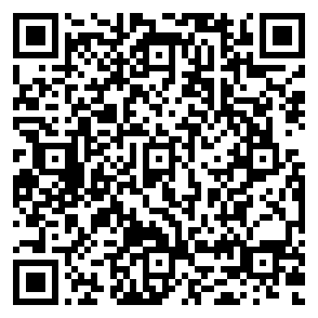

# DaVinci Resolve Speed Editor over Bluetooth on Linux — the complete fix

Make the **Blackmagic DaVinci Resolve Speed Editor** work over **Bluetooth**
(HID-over-GATT) on Linux — including inside a distrobox/podman container —
without the UI lag that otherwise makes it unusable.

Tested with: DaVinci Resolve Studio 19.1.x, Arch Linux, kernel 7.2.x,
BlueZ 5.87, Speed Editor firmware with the `bmd_kbd_auth` handshake.

---

## The four problems (and fixes)

### 1. udev permissions
Over Bluetooth the panel is exposed by BlueZ via `uhid` at
`/sys/devices/virtual/misc/uhid/0005:1EDB:DA0E.*`, which has **no
`idVendor`/`idProduct` attributes**. Blackmagic's udev rules
(`ATTRS{idVendor}=="1edb"`) never match, so `/dev/hidraw*` stays `0600
root:root` and Resolve silently ignores the panel.

**Fix:** [`99-blackmagic-hidraw.rules`](99-blackmagic-hidraw.rules) — matches
`KERNELS=="*:1EDB:DA0E.*"` (Bluetooth) as well as the USB path.

### 2. BlueZ truncates numbered GET_REPORT replies
`bt_uhid_get_report_reply` (`src/shared/uhid.c`) computed the reply size
without accounting for the Report ID byte, so the **last byte of every
numbered report read via hidraw was dropped** (reads as `0x00`). That single
byte corrupts the auth challenge Resolve reads → every handshake fails →
Resolve retries every ~1.1 s → the retry loop stalls the UI thread (the
"lag").

Fixed upstream: commit
[`dc2eb1394f`](https://github.com/bluez/bluez/commit/dc2eb1394f)
*"shared/uhid: Fix size of Get Report reply with a Report ID"* (2026-09-24),
expected in BlueZ 5.88. Backport for 5.87:
[`bluez/bluez-uhid-getreport-size.patch`](bluez/bluez-uhid-getreport-size.patch)
+ [build instructions](bluez/README-BLUEZ-PATCH.md).

### 3. Resolve rejects the *fixed* BlueZ ("BlueZ daemon version too old")
DaVinci Resolve 19.1.x compares the return value of `HIDIOCGFEATURE` against
the **truncated** sizes (7 / 32 / 9 — the buggy-BlueZ values) and, on
Bluetooth, treats the *correct* values (8 / 33 / 10) as malformed data:

```
SyManager | ERROR | BlueZ daemon version too old, reports malformed data.
SyManager | ERROR | Failed to add device.
```

Result: with a fixed BlueZ the panel is *rejected at startup* (no LEDs, no
input). The checks are three `cmp eax, N` in `/opt/resolve/bin/resolve`
(offsets `0x4002C71`, `0x4003C05`, `0x40041F6` for 19.1.x).

**Fix:** [`resolve-patch.sh`](resolve-patch.sh) — a 3-byte patch (7→8, 32→33,
9→10) applied inside the container. Re-apply after every Resolve update.

### 4. The 600-second authentication
The panel only reports input after a mutual challenge/response handshake on
feature report `0x06` (public algorithm, from
[smunaut/blackmagic-misc](https://github.com/smunaut/blackmagic-misc),
Apache-2.0 — see [NOTICE](NOTICE)). The handshake returns a 600 s timeout.

With fixes #2 and #3, Resolve authenticates the panel itself at startup and
renews the handshake every ~5 minutes (observed via GATT: the panel's 600 s
countdown resets at ~300 s intervals) — **no daemon needed**. If your panel
ever goes quiet (firmware differences, Resolve not renewing over BLE),
[`ble_auth.py`](ble_auth.py) performs the handshake and re-authenticates every
~500 s as a systemd user service. Don't run both: their periodic resets fight
each other.

---

## Install

```bash
git clone https://github.com/rudahssilva/speed-editor-davinci-resolve-linux-bluetooth.git
cd speed-editor-davinci-resolve-linux-bluetooth
./install.sh
```

`install.sh` does (with `sudo` where needed):

1. Installs the udev rule (group = your primary group, no logout needed).
2. Installs `read_hid.py` + `ble_auth.py` to `~/.local/bin/` and enables the
   `speed-editor-ble-auth` systemd user service (auth fallback).
3. Applies the 3-byte Resolve patch inside your distrobox container
   (default `davincibox`, override with `CONTAINER=...`).
4. Probes your BlueZ: if the buggy GET_REPORT size is detected, it prints the
   exact steps to build the one-line fix
   ([`bluez/README-BLUEZ-PATCH.md`](bluez/README-BLUEZ-PATCH.md)).

Useful:

- `./check.sh` — quick diagnostic (node, bus, permissions).
- `./read_hid.py --no-auth` — live input dump (buttons/wheel).
- `./repair.sh` — re-pair the panel after a reset
  (hold `CUT + SMTH CUT` for 3 s to reset; the panel remembers one host).

## Files

| File | Purpose |
|------|---------|
| `99-blackmagic-hidraw.rules` | udev permissions (USB + Bluetooth) |
| `bluez-uhid-getreport-size.patch` | one-line BlueZ backport (upstream fix) |
| `bluez/README-BLUEZ-PATCH.md` | Arch PKGBUILD build instructions |
| `resolve-patch.sh` | 3-byte patch for the Resolve binary checks |
| `ble_auth.py` | auth daemon (fallback/bootstrap) |
| `read_hid.py` | HID tool + `bmd_kbd_auth` implementation |
| `check.sh`, `tools/parse_btmon.py`, `repair.sh` | diagnostics |
| `docs/FORUM_POST.md` | full write-up (forum post) |

## FAQ

**Does the Resolve patch need re-applying after a Resolve update?**
Yes — the updater overwrites `/opt/resolve/bin/resolve`. `resolve-patch.sh`
verifies the bytes before touching anything: if the offsets moved (new
version) or Blackmagic fixed the checks, it refuses to patch and says so.

**Is the Resolve patch needed by everyone who updates BlueZ?**
It's the other way around: with the *fixed* BlueZ the patch becomes
*required* for Bluetooth users on Linux.

|                    | old (buggy) BlueZ           | fixed BlueZ (5.88+)       |
|--------------------|-----------------------------|---------------------------|
| stock Resolve      | panel accepted, auth always fails → retry loop → **lag** | panel rejected ("BlueZ daemon version too old") → **dead** |
| patched Resolve    | rejected (don't use)        | **works, no lag** ✅      |

USB is unaffected (the checks only fire on the Bluetooth transport), and
Windows/macOS don't use BlueZ. The durable fix is for Blackmagic to accept
the correct reply sizes in Resolve (see `docs/FORUM_POST.md`).

## Support

This project is free (MIT). If it saved you a weekend of debugging, a
donation is appreciated but never required:

- **Pix (Brasil)** — escaneie o QR ou use uma das chaves:

  

  - chave aleatória: `cfdb1eff-d7e0-43e3-8233-3040d1a0f323`
  - e-mail: `sourudahsilva@gmail.com`

- **International** (outside Brazil, Pix isn't available): open
  [wise.com/pay/me/rudahs1](https://wise.com/pay/me/rudahs1) and pay by card,
  Apple/Google Pay or Wise balance — Wise converts to BRL automatically.

  Prefer a direct transfer? USD account details (Wise, receive-only):

  ```
  Name:            Rudah Santos e Silva
  Account type:    Checking
  Routing (ACH/wire): 026073150
  Account number:  8314576918
  Bank:            Community Federal Savings Bank
                   89-16 Jamaica Ave, Woodhaven, NY 11421, USA
  SWIFT/BIC:       CMFGUS33
  ```


## Contributing

Issues and PRs welcome — see [CONTRIBUTING.md](CONTRIBUTING.md). Most useful
contributions: test reports from other distros/BlueZ versions, and updated
Resolve binary offsets when a new release moves them.

## License

MIT for this repository's code. Third-party material: the `bmd_kbd_auth`
constants come from [smunaut/blackmagic-misc](https://github.com/smunaut/blackmagic-misc)
(Apache-2.0), and the BlueZ fix is the upstream commit by Luiz Augusto von
Dentz (Intel), GPL-2.0 — see [LICENSE](LICENSE) and [NOTICE](NOTICE).
